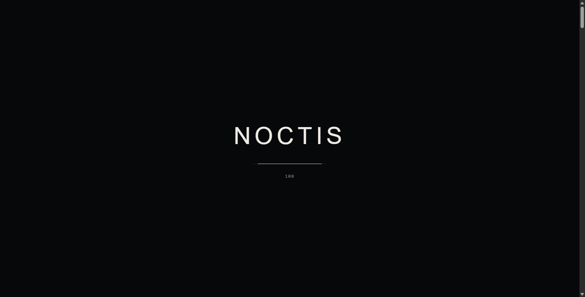
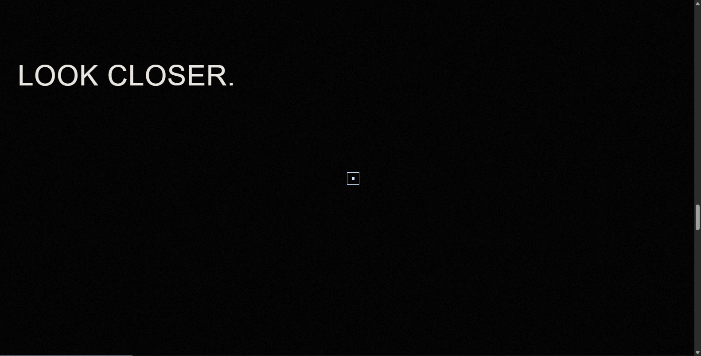
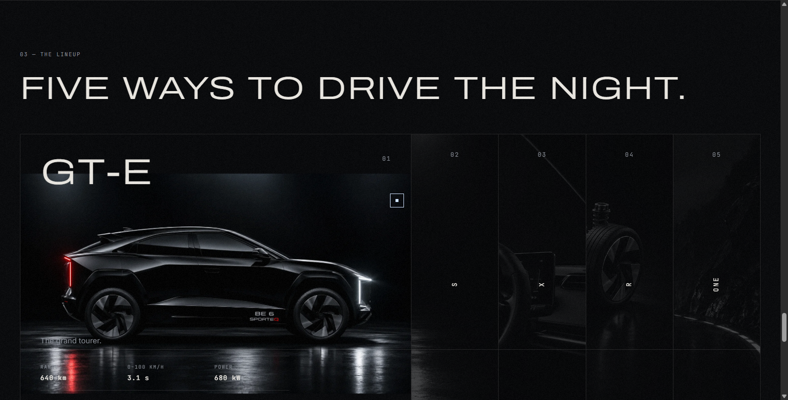
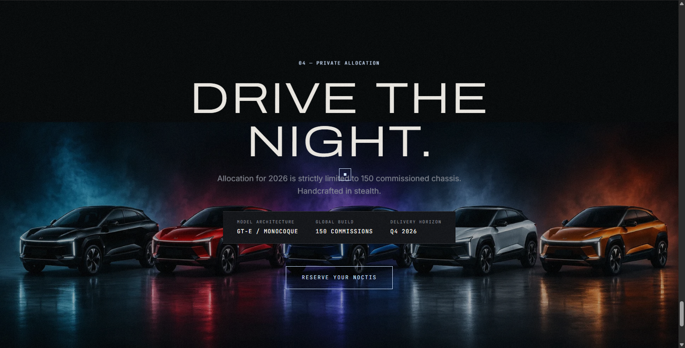
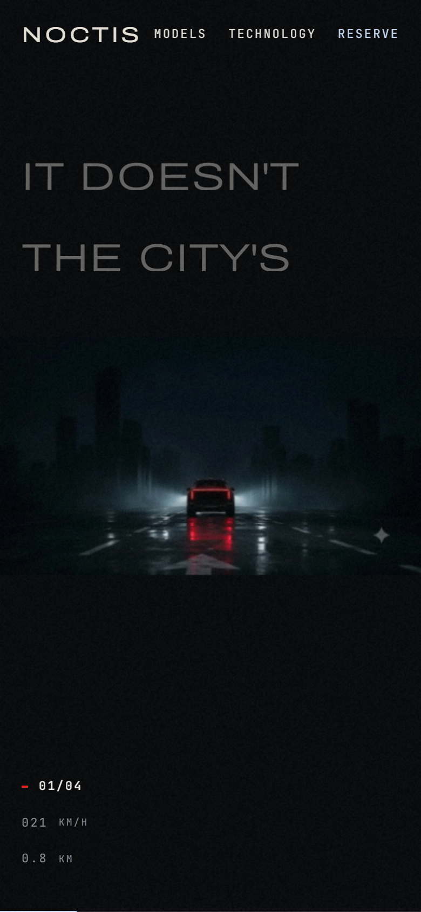
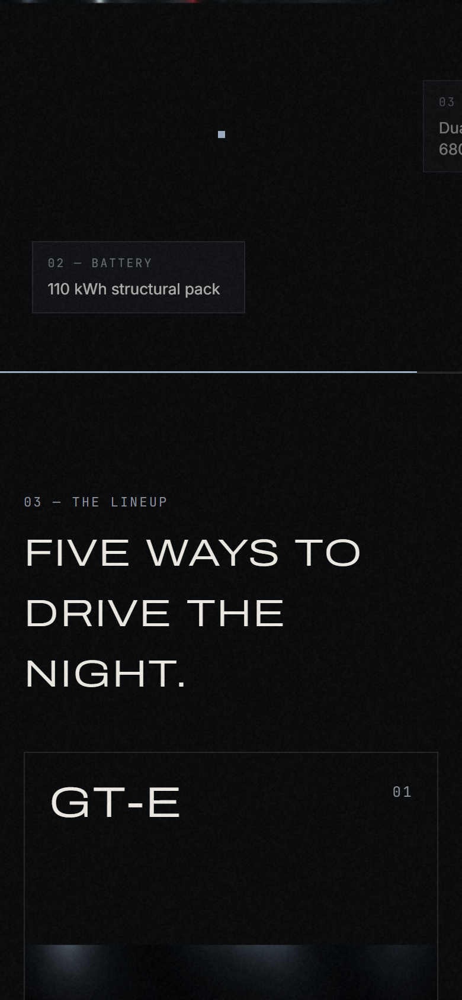

# NOCTIS EV Experience

> **An independent, unofficial design concept inspired by the Mahindra BE 6.**
> This is NOT an official Mahindra product or website. All car designs, brand names, and content are fictional and created for portfolio purposes only.

---

<div align="center">

[](https://saishashank112.github.io/noctis-ev-experience/)
[](LICENSE)
[](https://developer.mozilla.org/en-US/docs/Web/HTML)
[](https://developer.mozilla.org/en-US/docs/Web/CSS)
[](https://developer.mozilla.org/en-US/docs/Web/JavaScript)

**[→ View Live Demo](https://saishashank112.github.io/noctis-ev-experience/)**

</div>

---

## Overview

**NOCTIS** is a premium, minimal, single-page scrollytelling website built entirely with plain HTML, CSS, and vanilla JavaScript — no frameworks, no build tools. The mood: a city in total blackout at night where the car's light is the only light in the world. Everything feels quiet, expensive, and precise.

The site scrubs through **713 hero frames** and **238 dismantle frames** — all as WebP sequences rendered on `<canvas>` — driven by scroll position, giving the feel of a cinema-quality video under the user's scroll.

---

## Screenshots

### Desktop

| Hero | Dismantle |
|------|-----------|
|  |  |

| Lineup | Reserve |
|--------|---------|
|  |  |

### Mobile

| Hero | Lineup |
|------|--------|
|  |  |

---

## Features

| Feature | Detail |
|---------|--------|
| 🎬 **Canvas Scrollytelling** | 713-frame hero + 238-frame dismantle sequence scrubbed by scroll, with raf lerp and cover-fit drawing |
| ⬛ **Preloader** | Xenon progress line grows centre-out with load %, first 40 hero frames loaded before reveal |
| 🎯 **Custom Headlight Cursor** | 6px dot + 28px ring, morphs into a 44×2px light bar over interactive elements (desktop only) |
| 📽 **Film Grain Overlay** | Noise tile shifted ~8×/sec at 3–4% opacity, zero performance cost |
| 🚗 **Lineup Accordion** | 5 full-height vertical slides, one always open; car "drives in" 6% on open |
| 🔧 **Dismantle Callouts** | 4 hairline callout lines appear after 70% dismantle progress, positions tweakable in `config.js` |
| 📋 **Commission Modal** | Full private allocation form with confirmation state |
| 📱 **Responsive** | Mobile WebP frame sets (960px wide), portrait contain-fit drawing, accordion stacks vertically |
| ♿ **Reduced Motion** | All animations skipped; cursor hidden; lerp disabled when `prefers-reduced-motion: reduce` |
| 🎨 **Zero Gradients** | Strictly flat solid colours, 1px hairlines, photography and type only |

---

## Technology Stack

| Layer | Technology |
|-------|-----------|
| **Markup** | HTML5 — semantic sections, `<canvas>`, `<dialog>`-style modal |
| **Styling** | CSS3 — Custom Properties, `clamp()`, `min()`, sticky positioning, mix-blend-mode |
| **Scripting** | Vanilla JavaScript ES6+ — no libraries, no bundler |
| **Fonts** | Google Fonts: Archivo Variable (display), Inter (body), JetBrains Mono (HUD/labels) |
| **Canvas API** | 2D context, devicePixelRatio scaling (capped at 2), cover-fit / contain-fit drawing |
| **Intersection Observer** | Line-reveal entrance animations for non-pinned sections |
| **Frame Processing** | Python 3 + Pillow — natural-sort, stutter-free clip joins, WebP conversion pipeline |
| **Hosting** | GitHub Pages via GitHub Actions (`actions/deploy-pages@v4`) |

---

## Project Structure

```
noctis-ev-experience/
├── index.html              # Single-page markup
├── styles.css              # Full design system
├── main.js                 # Canvas scrollers, cursor, preloader, accordion, modal
├── config.js               # Frame counts, paths, chapter ranges, callout coords
│
├── assets/
│   ├── frames/
│   │   ├── hero/           # 713 × WebP 1600px   (23.76 MB)
│   │   ├── hero-mobile/    # 713 × WebP 960px    (9.30 MB)
│   │   ├── dismantle/      # 238 × WebP 1600px   (22.73 MB)
│   │   └── dismantle-mobile/ # 238 × WebP 960px  (8.59 MB)
│   └── cars/
│       ├── gt-e.webp       # GT-E matte graphite grand tourer
│       ├── s.webp          # S four-door sport sedan
│       ├── x.webp          # X SUV coupe roofline
│       ├── r.webp          # R two-seat track coupe
│       ├── one.webp        # ONE concept hypercar
│       └── reserve-bg.webp # Fleet panoramic for reserve section
│
├── screenshots/            # Desktop & mobile captures for README
│   ├── desktop-hero.png
│   ├── desktop-dismantle.png
│   ├── desktop-lineup.png
│   ├── desktop-reserve.png
│   ├── mobile-hero.png
│   └── mobile-lineup.png
│
└── .github/
    └── workflows/
        └── pages.yml       # GitHub Pages deployment workflow
```

---

## Design Tokens

```css
--asphalt:  #07080A   /* page background */
--graphite: #121418
--fog:      #8A8F98
--bone:     #EDEAE4   /* primary text */
--xenon:    #CFE3FF   /* light accent */
--taillight:#E1251B   /* tiny accents only */
--hairline: rgba(237,234,228,0.12)
```

**Strict rules:** No gradients of any kind · No glassmorphism / backdrop-filter / blur · No drop shadows · No rounded "bubbly" cards · No emojis · Only flat solid colours, 1px hairlines, photography and type.

---

## Local Development

No build step. No npm install. Just serve the directory:

```bash
# Python (built-in)
python -m http.server 5500

# VS Code Live Server
# Right-click index.html → "Open with Live Server"
```

Then open **http://localhost:5500** in Chrome or Edge.

> [!NOTE]
> The site preloads the first 40 hero frames before showing anything. On first run this may take a few seconds depending on disk speed (assets are ~65 MB total).

---

## Frame Processing Pipeline

The raw source clips were processed with a Python + Pillow pipeline:

1. **Natural sort** each clip folder (frame2 before frame10)
2. **Join hero clips** — clip1 → clip2 → clip3, skipping the first frame of clip3 (identical to last of clip2) to prevent stutter
3. **Convert to WebP** — 1600px wide, quality 78 (desktop); 960px wide, quality 72 (mobile)
4. **Renumber** — `frame_0001.webp` → `frame_NNNN.webp`, no spaces in paths

| Output folder | Frames | Size |
|---|---|---|
| `assets/frames/hero/` | 713 | 23.76 MB |
| `assets/frames/hero-mobile/` | 713 | 9.30 MB |
| `assets/frames/dismantle/` | 238 | 22.73 MB |
| `assets/frames/dismantle-mobile/` | 238 | 8.59 MB |

---

## How the Scrollytelling Works

Each pinned section is a **tall wrapper div** (height set in `config.js`, e.g. 600vh). Inside it, a `stage` div with `position: sticky; top: 0; height: 100vh` holds the canvas and overlay text.

```js
// progress formula
const progress = Math.max(0, Math.min(1,
  -wrapper.getBoundingClientRect().top / (wrapper.offsetHeight - innerHeight)
));
const targetFrame = Math.round(progress * (frameCount - 1));

// RAF lerp
current += (targetFrame - current) * 0.15;
if (Math.round(current) !== lastDrawn) redraw();
```

Scrolling up plays the sequence backwards. When the wrapper's scroll distance runs out, the page continues normally to the next section.

---

## Disclaimer

> **NOCTIS is an independent, unofficial design concept.** It is NOT affiliated with, endorsed by, or connected to Mahindra & Mahindra Ltd. in any way. The visual language was inspired by the Mahindra BE 6 electric vehicle, but all brand names, car models, specifications, and copy are entirely fictional and created solely for portfolio and educational purposes. No commercial use is intended.

---

## Author

**Sai Shashank Allampally**

- GitHub: [@saishashank112](https://github.com/saishashank112)

---

<div align="center">

Made with obsession over every pixel · No frameworks were harmed in the making of this site

</div>
